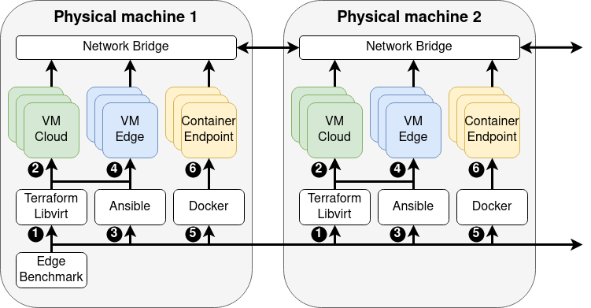

# Continuum
Continuum is a deployment and benchmarking framework for the edge-cloud compute continuum. Continuum offers the following features:

1. Continuum automates the creation of a cluster of cloud, edge, and endpoint virtual machines to emulate a compute continuum environment.
2. Users configure experiments with YAML experiment files plus reusable environment and software profiles.
3. Continuum automatically installs operating services, resource managers, and applications inside the emulated cluster based on the user's preference. Available modules include MQTT, Kubernetes, KubeEdge, OpenFaaS, and machine learning application examples; listing a module does not certify an application workflow. Consult `docs/release_certification_matrix.md` for exact release-supported combinations.
4. Continuum can automatically benchmark the resource managers and applications installed in the emulated cluster, and report metrics and logs back to the user.
5. Continuum is easily extendable, allowing users to add support for more infrastructure providers, operating services, resource managers, and applications.

This branch contains the structured YAML/planning-engine rework. QEMU is a provider module, not part of Continuum core; GCP and AWS are provider modules as well. Current certification status is tracked in `docs/release_certification_matrix.md`, while release-readiness policy is defined in `docs/rework_milestone_release_plan.md`; rework outputs remain milestone/pre-release artifacts until the approved reproduction scope, bounded support inventories and final acceptance gates close with explicit user approval. Full old-main parity is a historical candidate inventory, not the pre-main release scope. Host execution uses the normal-user workflow in `docs/smoke_runner_isolation.md`.

## Features
Continuum's public feature surface includes the following software families. For the rework branch, treat these as module families and read public support claims together with `docs/release_certification_matrix.md`:

1. **Infrastructure**: Virtual machine provisioning through QEMU/KVM on local bare-metal devices.
2. **Operating Services**: Continuum can set up an MQTT broker on edge device for lightweight communication to endpoint users.
3. **Resource Manager**: Continuum contains module paths for Kubernetes, KubeEdge, Mist, KubeControl, Kata, endpoint runtime, observability, and OpenFaaS. Only the combinations marked `certified` in the release matrix should be described as release-supported on this branch.
4. **Applications and application back-ends**: Continuum can run benchmark stages implemented as VM, container, or serverless workloads. The rework branch currently certifies only the exact application rows named in the release matrix.

## How it works
Continuum has the following architecture:

<div align="center">
    
</div>
<br>

The user-visible execution flow consists of **infrastructure deployment**, **software installation**, and **benchmark/application execution**. The active runtime also has bootstrap/planning and artifact/resume/teardown boundaries, documented in `docs/runtime_execution_pipeline.md`.

1. **Infrastructure configuration:** Libvirt configuration files for QEMU/KVM are created based on the user's preferences.
2. **Infrastructure execution:** The configuration files are executed, creating QEMU/KVM virtual machines connected through network bridges.
3. **Software configuration:** Ansible is configured for software installation based on the configured infrastructure.
4. **Software execution:** Ansible playbooks are executed, installing operating services and resource management software on each machine. This step includes setting up resource management clusters such as Kubernetes.
5. **Benchmark configuration** The benchmark is configured and prepared based on the user's preferences.
6. **Benchmark execution:** Applications (encapsulated in containers) are executed using resource managers running on the emulated infrastructure (Kubernetes, KubeEdge, etc.). Meanwhile, application- and system-level metrics are captured, processed, and presented to the user.

## Who Uses Continuum
The Continuum framework has been used for scientific research, leading to (i) publications, (ii) Bachelor and Master of Science projects and theses, (iii) has been the topic of multiple demos, and (iv) has been awarded artifact reproducibility badges. More information on the Continuum project and its contributors can be found [here](https://atlarge-research.com/continuum/).

### Citation
When using Continuum for research, please cite the work as follows:
```
@inproceedings{2023-jansen-continuum,
    author    = {Matthijs Jansen and
                 Linus Wagner and
                 Animesh Trivedi and
                 Alexandru Iosup},
    title     = {Continuum: Automate Infrastructure Deployment and Benchmarking in the Compute Continuum},
    booktitle = {Proceedings of the First FastContinuum Workshop, in conjuncrtion with ICPE, Coimbra, Portugal, April, 2023},
    year      = {2023},
    url       = {https://atlarge-research.com/pdfs/2023-fastcontinuum-continuum.pdf},
}
```
The presentation slides of this work can be found [here](https://atlarge-research.com/talks/2023-continuum-framework-fastcontinuum.html)

Other work on the Continuum framework includes:
```
@inproceedings{2023-jansen-refarch,
    author    = {Matthijs Jansen and
                 Auday Al-Duilamy and
                 Allesandro Vittorio Papadopoulos and
                 Animesh Trivedi and
                 Alexandru Iosup},
    title     = {The {SPEC-RG} Reference Architecture for the Compute Continuum},
    booktitle = {The 23rd IEEE/ACM International Symposium on Cluster, Cloud and Internet Computing, CCGRID 2023, Bangalore, India, May 1-4, 2023},
    year      = {2023},
    url       = {https://atlarge-research.com/pdfs/2023-ccgrid-refarch.pdf},
}
```
The presentation slides of this work can be found [here](https://atlarge-research.com/talks/pres-2022-compsys-mjansen.html) and [here](https://atlarge-research.com/talks/poster-2022-ictopen-mjansen.html).

### Student Work
The Continuum framework has been used by many students from the Vrije University Amsterdam:

**Bachelor Thesis**
* Daniel Berzak: Embedded Domain Specific Language: A Streamlined Approach for Framework Abstraction

**Master Thesis**
* Edgardo Reinoso Campos: Serverless Computing at the Edge in Precise Agriculture (ongoing)
* Antonios Sklavos: Exploring the Performance-Isolation Trade-off for Isolation Mechanisms (ongoing)
* Tim van Kemenade: A Comparison of Scheduling Algorithms in the Compute Continuum (ongoing)

**Student Research Projects**
* Felix Goosens: Edge Continuum Framework on an ARM Raspberry Pi Cluster
* David Freina et al: Serverless Computing in the Edge Continuum
* Andreas Frangos et al: Performance Variability and Resource Analysis in Serverless Applications

### Demo
The Continuum framework has been part of four classes with a demo, organized by the VU Amsterdam Bachelor and Master program Computer Science, as well as the Dutch Research School for high-quality research and education in computer systems and Imaging (ASCI).

for over 100 students and researchers in total. Specifically, it has been demoed in the following occasions:
* Distributed Systems (2021) - Part of the VU Amsterdam MSc program Computer Science
* ASCI A24 (2022) - A course in the Dutch Research School for high-quality research and education in computer systems and Imaging (ASCI)
* Distributed Systems (2022) - Part of the VU Amsterdam MSc program Computer Science
* ASCI A22 (2023) - A course in the Dutch Research School for high-quality research and education in computer systems and Imaging (ASCI)
* Computer Networks (2023) - Part of the VU Amsterdam BSc program Computer Science

<p>
  
  
</p>

### Artifact
The Continuum framework has been awarded the IEEE reproducibility badges for Open Research Objects (ORO) and Reusable/Research Objects Reviewed (ROR). These badges have been awarded by independent reviewers as part of the CCGRID 2023 Artifact Track. For more information on these badges, see [here](https://ccgrid2023.iisc.ac.in/call-for-artifacts/). The code and instructions for this artifact are available on GitHub [here](https://github.com/atlarge-research/continuum/tree/CCGRID2023-Artifact-Evaluation).

## Demo
Historically, Continuum has supported multiple virtual machine infrastructure deployment platforms, most notably QEMU for execution on local hardware and Google Cloud for execution in the cloud. On the rework branch, this demo is limited to local QEMU/KVM. Exact provider certification status is tracked in `docs/release_certification_matrix.md`. Google Cloud instructions from the CCGRID 2023 artifact remain available in the historical README [here](https://github.com/atlarge-research/continuum/tree/CCGRID2023-Artifact-Evaluation), but they are not release-certified on this branch yet.

This demo requires a single machine and a Linux operating system that supports QEMU/KVM and Libvirt. We recommend running the demo on an Ubuntu 20.04 machine but have also tested on Ubuntu 22.04. If you don't have access to such a machine, see the Appendix for tips on how to install this in a VM. We recommend installing the framework bare-metal for more reliable performance metrics.

The demo contains two parts:

1. Install the framework
2. Use the framework

In part one, we install the Continuum framework and use the framework in part 2. The historical framework has supported execution on multiple physical machines through a network bridge. On the rework branch, only the exact rows certified in `docs/release_certification_matrix.md` should be treated as release-supported. For more questions, open a GitHub Issue or mail m.s.jansen@vu.nl.

Software versions tested:

- QEMU 6.1.0
- Libvirt 6.0.0
- Docker 20.10.12
- Python 3.8.10
- Ansible 2.13.2

### Part 1: Install the framework
We start by installing all requirements for the Continuum framework. We assume the operating system is Ubuntu 20.04, either natively or via a VM. Ubuntu 22.04 should also work, but commands and packages might slightly differ.

```bash
# 1. Install the VM requirements
sudo apt update
sudo apt install qemu-kvm libvirt-daemon-system libvirt-clients bridge-utils

# 1.1. Give your user sufficient permissions
# After these steps, refresh you session to make the group addition take effect.
sudo adduser $USER libvirt
sudo adduser $USER kvm

# 1.2. Check if the installation was succesful
# If not, you may need to use `sudo systemctl enable --now libvirtd`
qemu-system-x86_64 --version
sudo systemctl status libvirtd

# 1.3. Force libvirt to use QEMU.
echo 'export LIBVIRT_DEFAULT_URI="qemu:///system"' >> ~/.bashrc
source ~/.bashrc

# 2. Install Docker (see Docker website for alternative instructions)
sudo apt-get install ca-certificates curl gnupg lsb-release

sudo mkdir -p /etc/apt/keyrings
curl -fsSL https://download.docker.com/linux/ubuntu/gpg | sudo gpg --dearmor -o /etc/apt/keyrings/docker.gpg

echo \
    "deb [arch=$(dpkg --print-architecture) signed-by=/etc/apt/keyrings/docker.gpg] \
    https://download.docker.com/linux/ubuntu $(lsb_release -cs) stable" | \
    sudo tee /etc/apt/sources.list.d/docker.list > /dev/null

sudo apt-get update
sudo apt-get install docker-ce docker-ce-cli containerd.io docker-compose-plugin

# After these steps, refresh you session to make the group addition take effect.
sudo groupadd docker
sudo usermod -aG docker $USER
sudo systemctl enable docker.service
sudo systemctl enable containerd.service
# Now refresh you SSH session by logging in / out

# Continuum creates a local docker registry using http
# Http support needs to be enabled
http_ip=$(hostname -I | awk '{print $1;}')
echo '{ "insecure-registries":["${http_ip}:5000"] }' | sudo tee -a /etc/docker/daemon.json
sudo systemctl restart docker

# 3. Install the Continuum framework
mkdir ~/.ssh
touch ~/.ssh/known_hosts

git clone https://github.com/atlarge-research/continuum.git
cd continuum

# 4. Install Python and some packages, including Ansible
sudo add-apt-repository --yes ppa:ansible/ansible
sudo apt install python3 python3-pip ansible
pip3 install -r requirements.txt

# 5. Edit the Ansible configuration as follows on Ubuntu 20.04:
# Under `[defaults]`, add `callback_enabled = profile_tasks`
# Under `[defaults]`, add `command_warnings = False`
# For Ubuntu 22.04, add just the following: callbacks_enabled=profile_tasks
sudo vim /etc/ansible/ansible.cfg

# 6. Setup up bridged networking on the machine
# First, delete any virtual bridges
virsh net-destroy default
virsh net-undefine default

# Check that no bridges exist anymore
virsh net-list --all

# Now create the new bridge itself
# Make a backup of the old network settings, then edit the new one
# Use `ip -a` to find the name of your network interface, for example, ens3
# and to find its IP, for example, 10.0.2.15
# Find the gateway address using `ip r` (the first IP on the first line)
# An example command could look like this:
sudo cp /etc/netplan/00-installer-config.yaml /etc/netplan/00-installer-config.yaml.bak

sudo su
cat > /etc/netplan/00-installer-config.yaml <<EOF
network:
    ethernets:
    ens3:
        dhcp4: false
        dhcp6: false
    bridges:
    br0:
        interfaces: [ens3]
        addresses: [10.0.2.15/16]
        gateway4: 10.0.2.2
        nameservers:
        addresses: [1.1.1.1, 8.8.8.8]
        search: []
        parameters:
        stp: true
        dhcp4: false
        dhcp6: false
    version: 2
EOF
exit

# Apply the changes
sudo netplan generate
sudo netplan apply

# Check if the bridge br0 was successfully created
# And check that the network interface, for example, ens3, doesn't have an IP listed anymore, but br0 does instead.
brctl show
ip a

# Enable IP forwarding
sudo su
cat >> /etc/sysctl.conf <<EOF
net.bridge.bridge-nf-call-ip6tables = 0
net.bridge.bridge-nf-call-iptables = 0
net.bridge.bridge-nf-call-arptables = 0
EOF
exit

# Then execute this command
sudo sysctl -p /etc/sysctl.conf
```

### Part 2: Use the framework

For a QEMU run with remote physical workers, verify each worker's SSH host-key fingerprint through a trusted source, such as the worker console or its administrator. Enroll the verified key under the exact configured worker hostname or IP in the operator's OpenSSH known-hosts file, normally `~/.ssh/known_hosts`, before running Continuum. Physical connections reject missing or changed keys and open a fresh connection. Re-verify any replacement key after a worker rebuild or key rotation. The controller needs the OpenSSH SFTP client and workers need an SFTP subsystem for generated files. The worker's guest access keypair lives in `<base_path>/.continuum/ssh/`. Guest key bootstrap uses its existing policy.

Start with three YAML documents: an [experiment](configs/experiments/template.yaml) owns topology, run targets and benchmark intent; an [environment profile](configs/profiles/environment/template.yaml) owns provider, host and base-path settings; a [software profile](configs/profiles/software/template.yaml) owns module instances and their assignments. Profile references select the first existing file in the documented search order; they do not merge layered overrides. Check the selected source paths and resolved experiment lock. Software selectors AND predicates within each `match`, and `any_of` unions clauses. Benchmark assignment uses one `match`; validation requires exactly one executable pipeline stage. See the [configuration reference](docs/configuration_reference.md) and [configuration inventory](docs/configuration_inventory.md) for the full contracts.

The entry point accepts `python3 continuum.py --help` and `python3 continuum.py -v <experiment>.yaml` (`--verbose` also works). A direct run uses its selected profile's base path and really provisions resources. For a retained QEMU infrastructure → software → application walkthrough, use the existing normal-user wrapper and [host runbook](docs/smoke_runner_isolation.md). On the reviewed node4 host, keep the pinned Python 3.8.10/Ansible 2.13.2 environment and migrated storage. Choose a fresh, traversable parent under the allocated runtime root; the example `mkdir` refuses an existing destination, so select a new name if this one has already been used. If it fails, stop before the exports and choose an unused path; keep that same path for all three phases:

```bash
cd /home/matthijs/continuum
mkdir -m 755 /mnt/sdc/continuum_smoke/walkthrough-20261029-01
export CONTINUUM_SMOKE_BASE_ROOT=/mnt/sdc/continuum_smoke/walkthrough-20261029-01
export CONTINUUM_SMOKE_PYTHON=/home/matthijs/venvs/continuum/bin/python3
"$CONTINUUM_SMOKE_PYTHON" continuum.py --help
sh scripts/test/setup_agent_host.sh show-config
sh scripts/test/setup_agent_host.sh verify
sh scripts/test/run_smoke_host.sh check-prereqs --suite benchmark_smoke
```

Fresh QEMU infrastructure runs stop verified old Continuum guests of the same Unix account on the controller and scheduled workers, including guests from other base paths. Run one Continuum invocation per account per physical host. Use the resume phases to continue a retained run. Select the wrapper root through `CONTINUUM_SMOKE_BASE_ROOT`. Run the following phases in order and preserve each phase's result with the block below **before starting the next phase**.

| Phase and input | Command |
| --- | --- |
| [Infrastructure, prepared for resume](configs/experiments/benchmark_smoke/01_infra_k8s_three_vm.yaml) | `sh scripts/test/run_smoke_host.sh benchmark_k8s_resume_infra` |
| [Software on retained guests](configs/experiments/benchmark_smoke/02_software_k8s_three_vm.yaml) | `sh scripts/test/run_smoke_host.sh benchmark_k8s_resume_software` |
| [Image-classification application, then teardown](configs/experiments/benchmark_smoke/03_application_k8s_image_classification.yaml) | `sh scripts/test/run_smoke_host.sh benchmark_k8s_resume_application` |

Each alias shares `<CONTINUUM_SMOKE_BASE_ROOT>/benchmark_k8s_resume`, but writes its own latest **single-entry** result JSON. After each phase inspect index 1:

```bash
sh scripts/test/run_smoke_host.sh latest-result-summary benchmark_k8s_resume
sh scripts/test/run_smoke_host.sh latest-result-tail benchmark_k8s_resume stdout 1 --full
sh scripts/test/run_smoke_host.sh latest-result-tail benchmark_k8s_resume stderr 1 --full
sh scripts/test/run_smoke_host.sh latest-result-tail benchmark_k8s_resume metadata 1 --full
```

Preserve the printed `LATEST_RESULT` JSON and its referenced streams before the next invocation changes the latest pointer. The aggregate alternative `sh scripts/test/run_smoke_host.sh benchmark_k8s_resume` runs all three phases and writes one three-entry summary; inspect indexes 1, 2 and 3 in that case. Do not request index 3 from an individual application invocation.

Resume omits infrastructure from `run.targets` and requires unchanged revision, the same canonical base path/topology/software contract, compatible saved phase state and authenticated SSH preflight on every recorded guest. The final input requests teardown. The remaining `<base>/.continuum/state.json` is a last-known snapshot, not proof of live guests. Inspect `experiment_lock.yaml`, `logs/`, `test_results/`, actual benchmark outcomes and metric manifests/CSVs, any requested network NDJSON, and final owned-domain absence; a lock or success marker alone does not establish application success. The [runtime pipeline](docs/runtime_execution_pipeline.md) maps these artifacts to the parser, planner, provider, software hooks and application helpers.

The historical `base_images_rebuilt` list does not report QEMU cache decisions; `[]` does not mean no rebuild. Inspect the owning host's actual cache-decision logs, completed preparation output and matching ready sidecars, preserving source/time and before/after provenance. A ready marker alone does not identify which run created it. See the [cache contract](docs/qemu_cache_contract.md). Host cache priming, guest preload and `registry_refresh: missing|all` are distinct.

On failure, preserve results and state/lock first, then inspect the exact indexed full streams, logged SSH hints, `virsh --connect qemu:///system list --all` and the affected guest using the [VM debugging runbook](docs/vm_debugging_runbook.md). Available module types and parser-accepted examples are separate from exact validated workflows: the [matrix](docs/release_certification_matrix.md) and [current handoff](docs/rework_release_handoff.md) distinguish selected development evidence from pending final-candidate acceptance and historical certification. Legacy `.cfg` files under `configuration/` remain for historical reproduction; use the [migration notes](docs/migration_notes.md) for YAML replacements. All components can be extended as modules or profiles; open a GitHub Issue or email m.s.jansen@vu.nl with questions.

### Appendix
The Continuum framework is supposed to be run from an Ubuntu-like operating system. The framework has been extensively tested on Ubuntu 20.04. In this part, we show how to create an Ubuntu 20.04 VM that you can use to run Continuum in. This example is supposed to be executed on a Linux machine.
```bash
# 1. Install the VM software QEMU, KVM, and Libvirt
sudo apt update 
sudo apt install qemu-kvm libvirt-daemon-system libvirt-clients bridge-utils

# Give your user sufficient permissions - this may require you to refresh your session
sudo adduser $USER libvirt
sudo adduser $USER kvm

# Exit your shell and open a new one for the permissions to take effect

# Check if the installation was succesful
# If not, you may need to use `sudo systemctl enable --now libvirtd`
qemu-system-x86_64 --version
sudo systemctl status libvirtd

# Download the Ubuntu 20.04 server image
wget https://releases.ubuntu.com/20.04.3/ubuntu-20.04.3-live-server-amd64.iso

# Create a QCOW disk as storage for your VM (at least 20 GB of disk space is advised)
qemu-img create -f qcow2 ubuntu.img 20G

#############
# Boot the VM
#############
# 1. On a system with a GUI
# - This will open a new window for the VM
# - Use at least 4 GB of RAM and 4 CPUs
sudo qemu-system-x86_64 -hda ubuntu.img --enable-kvm -m 8G -smp 4 -boot d -cdrom ubuntu-20.04.3-live-server-amd64.iso -cpu host -net nic -net user
#############
# 2. On a system without a GUI
sudo qemu-system-x86_64 -hda ubuntu.img --enable-kvm -m 8G -smp 4 -boot d -cdrom ubuntu-20.04.3-live-server-amd64.iso -cpu host -net nic -net user,hostfwd=tcp::7777-:22
# 2.1. Access the VM from an OS with GUI: You can now SSH in to machine
ssh -p 7777 ubuntu@127.0.0.1
# 2.2 On the VM, execute remmina so you can see the GUI of the VM on your machine
sudo apt install remmina
remmina
# 2.3 This should open the Remmina screen for you. Click on the + icon to create a new connection. Under protocol, select “VNC”, and then under server, add the VNC address displayed in the terminal where you started the VM (for example, 127.0.0.1:5900). Click save and connect to connect to the VM.
#############

# Finish the initialization of the VM
# Don't forget to install the open-SSH client during the installation
# Then, shut the VM down and re-launch
sudo qemu-system-x86_64 -hda ubuntu.img --enable-kvm -m 8G -smp 4 -cpu host -net nic -net user,hostfwd=tcp::7777-:22 --name ubuntu

# On a system with a GUI: The VM should open automatically
# On a system without a GUI: 
ssh [username]@localhost -p 7777
```

# Acknowledgment
This work is funded by NWO TOP OffSense (OCENW.KLEIN.209).
