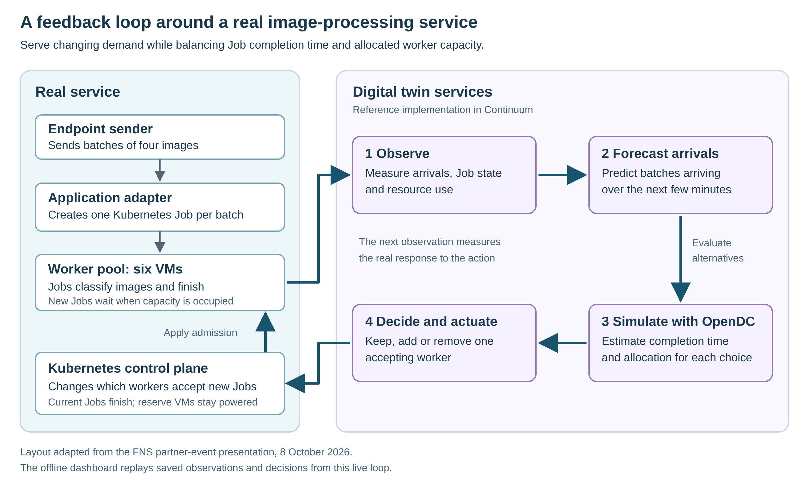
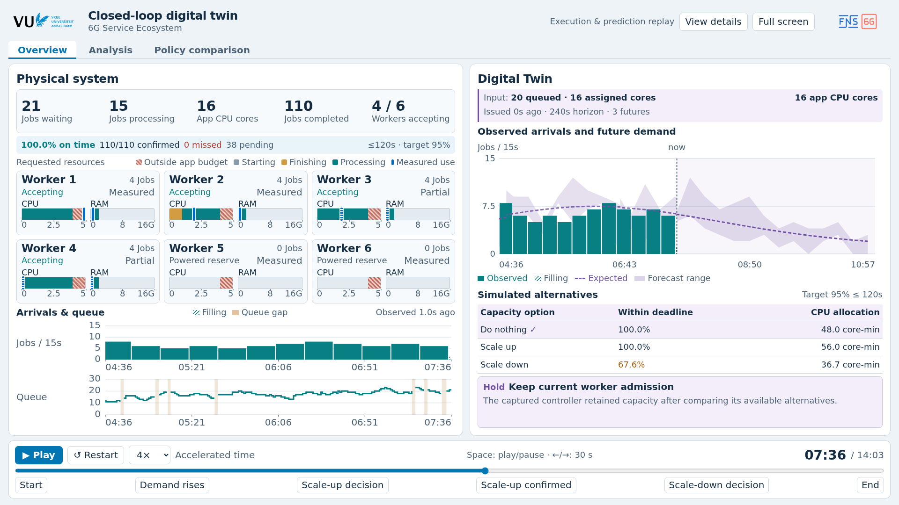

# Closed-loop digital twin: live reference demonstration

Provision a Kubernetes cluster with Continuum, run a real image-processing service, and let a digital twin change how many workers accept new Jobs. Compare static, reactive and forecast-based control, then build an offline dashboard from your own measurements.

For the OpenDT student project, build the new closed loop **in [OpenDT](https://github.com/atlarge-research/opendt)**. This Continuum implementation is a reference you can study or reuse. The [design](DESIGN.md#relationship-to-opendt) explains the relationship and the [OpenDT paper](https://atlarge-research.com/pdfs/2026-icpe-opendt.pdf) provides the research context.

## What you will run

The application is a cloud image-classification service with demand that rises and falls over time. An endpoint sends batches of four images to an adapter, the service's entry point. For each batch, the adapter creates a **Kubernetes Job**: a temporary task that runs an image classifier on a worker VM, stores the results and finishes. The classifier assigns labels to images; the digital twin forecasts how many batches will arrive.

Each worker can process only a limited number of Jobs at once. When demand exceeds available capacity, Jobs wait, increasing their response time. Keeping many workers allocated helps absorb peaks but leaves capacity reserved during quiet periods. The experiment compares three ways to balance service performance and allocated resources: keep capacity fixed, react to current demand, or anticipate demand using forecasts and simulation.

Here, **scaling up** means allowing an already-running reserve worker to accept new Jobs. **Scaling down** means stopping new assignments to a worker while its current Jobs finish. All worker VMs remain powered; the controlled quantity is how many accept work. The demo measures application capacity allocation, rather than physical energy savings. The idea is that worker VMs currently not accepting jobs are part of a warm VM pool managed by a cloud/cluster operator. The operator can quickly assign these warm VMs to users that require VMs. Hence, the user does not have to pay for worker VMs that do not accept jobs. 

The forecast-based controller observes the real service, forecasts future batch arrivals and uses **OpenDC** to estimate the effects of keeping, adding or removing an accepting worker. It chooses an action to reduce, keep, or increase allocation while targeting completion of at least 95% of Jobs within 120 seconds of their creation, including waiting time. Later observations show what actually happened and inform the next decision, closing the feedback loop. Meeting that target depends on the workload, hardware and model accuracy; it is not guaranteed.

*Follow the numbered steps clockwise, then follow the action through Kubernetes and the workers back to observation. These control services run in the Continuum reference; students from the DS course should build their loop in OpenDT. [Open the diagram full-size](docs/closed-loop.png).*

You will run the live service and compare the three policies, then use the offline dashboard below to inspect your recorded workload, forecasts, decisions and outcomes. The dashboard displays saved evidence without running the controller.

*The included reference dataset illustrates the dashboard. [Open the dashboard screenshot full-size](docs/replay-overview.png). Follow the steps below to display your own matched experiments.*

## 1. Provision the environment

Start with your course accounts on **two prepared physical cluster nodes**, with no VMs or Kubernetes yet running. Follow [Setup: from host accounts to a running service](SETUP.md) for the Continuum configuration, provisioning, image builds and service readiness checks.

The resulting environment has one control plane, six workers and one endpoint sender. Run setup and captures from the first physical node; build the offline replay on your laptop. The endpoint is a workload generator, not a Kubernetes worker.

After setup, open Bash at the repository root and define a shortcut for the demo helper:

~~~bash
demo() { bash application/image_batch/scripts/student_demo.sh "$@"; }
~~~

## 2. Submit a batch and inspect the service

Use the template service before starting measured experiments. The four-image batch matches the capture workload:

~~~bash
ADAPTER_URL=$(demo url)

curl --fail "$ADAPTER_URL/healthz"

tar -cf logs/student-demo/manual-batch.tar \
  -C application/image_classification/src/images \
  ILSVRC2012_val_00000001.JPEG ILSVRC2012_val_00000002.JPEG \
  ILSVRC2012_val_00000003.JPEG ILSVRC2012_val_00000004.JPEG

curl --fail -H 'Content-Type: application/x-tar' \
  -H 'X-Continuum-Workload-Run-ID: student-manual' \
  --data-binary @logs/student-demo/manual-batch.tar "$ADAPTER_URL/v1/batches"

demo kubectl get jobs,pods -n fns-demo
~~~

Submission returns HTTP 202 and a `request_id`. Replace `REQUEST_ID` below with that value:

~~~bash
curl --fail "$ADAPTER_URL/v1/batches/REQUEST_ID"
curl --fail "$ADAPTER_URL/v1/metrics"
~~~

Poll the request until it finishes. The status response includes result metadata; classification results stay cloud-side. Adapter metrics describe requests and timing, while the observer collects Kubernetes state and Prometheus resource samples.

Before capturing, wait for all manual Jobs to finish, then run `demo check` to check [forecast profile readiness](SETUP.md#check-the-service-and-forecast-inputs). Do not submit extra requests during the measured trio.

## 3. Capture a matched policy comparison

Keep the checkout, images, configuration and inventory unchanged across all three runs. Use the same seed and workload settings, and reserve the cluster for one capture at a time. The capture runner creates a separate namespace for each run and requires no other active Jobs anywhere in the cluster.

Create a fresh run directory and define the common command in the same Bash session:

~~~bash
RUN_TAG="student-$(date -u +%Y%m%d-%H%M%S)"
RUN_DIR="logs/student-demo/runs/$RUN_TAG"
mkdir -p "$RUN_DIR"

COMMON=(
  --seed 42 --admission-mode fifo
  --period-seconds 600 --cycles 4 --warmup-cycles 2
  --minimum-rate 0.02 --peak-rate 0.18
  --horizon-seconds 180 --scenarios 3 --followup-seconds 600
  --minimum-workers 1 --maximum-workers 6
  --arm-active-workers '{"fixed":5,"reactive":4,"forecast":4}'
  --require-evaluated-sender-fidelity
)

run_capture() {
  local arm="$1" active="$2" cadence="$3"
  shift 3
  demo capture "${COMMON[@]}" \
    --control-arm "$arm" --active-workers "$active" \
    --cadence-seconds "$cadence" \
    --output "$RUN_DIR/$arm" --namespace "fns-$RUN_TAG-$arm" "$@"
}
~~~

These are a teaching starting configuration, not a promise that one policy will outperform another. Each run sends arrivals for 40 minutes, including 20 minutes of warm-up, followed by up to 10 minutes of completion collection. Forecast control starts after warm-up; do not expect an immediate decision.

Preview all three configurations without contacting the cluster:

~~~bash
run_capture forecast 4 90 --preview
run_capture fixed 5 90 --preview
run_capture reactive 4 30 --preview
~~~

Then run the following **one at a time**, waiting for `CAPTURE_COLLECTED` and checking completion before continuing:

~~~bash
run_capture forecast 4 90
run_capture fixed 5 90
run_capture reactive 4 30
~~~

Static retains five accepting workers. Reactive and forecast control start with four and can adjust within the shared bounds. The shared per-policy allocation mapping keeps comparison accounting consistent; reactive checks every 30 seconds and forecast control every 90 seconds.

In a second terminal, inspect the current namespace without changing the workload:

~~~bash
demo() { bash application/image_batch/scripts/student_demo.sh "$@"; }
demo kubectl get namespaces
demo kubectl get nodes
~~~

Set `RUN_NAMESPACE` to the namespace printed by the capture, then inspect Jobs and the observer:

~~~bash
RUN_NAMESPACE="fns-REPLACE_WITH_RUN_TAG-forecast"
demo kubectl get jobs,pods -n "$RUN_NAMESPACE"
demo kubectl logs -n "$RUN_NAMESPACE" deployment/image-batch-adapter \
  -c opendt-observer --tail=20
~~~

On the capture host, each arm's output directory contains `endpoint.jsonl`, `observer/`, `controller/journal.jsonl`, frozen forecast/simulation inputs and final cluster inventories. The capture collects these before removing its namespace. `cleanup.json` and `observer-drain.json` record completion and restoration. Keep the whole directory.

If a command fails, stop the trio and preserve its output. Failed captures deliberately retain resources for diagnosis. Inspect `failure.json` and the live namespace with the instructor before removing resources or starting another run; a restarted process is not a resumed experiment. Use a fresh run directory for a replacement comparison.

## 4. Generate metrics and an offline report

After all three captures finish, run from the repository root in the original session:

~~~bash
demo python -m closed_loop_evidence \
  --capture "$RUN_DIR/fixed" --capture "$RUN_DIR/reactive" \
  --capture "$RUN_DIR/forecast" \
  --role pilot --output "$RUN_DIR/trio-metrics.json"

demo python -m reporting.assembly \
  --metrics "$RUN_DIR/trio-metrics.json" --output-dir "$RUN_DIR/report"
~~~

Open `report/report.pdf` beneath `RUN_DIR`. The portable `report/metrics.json` preserves the plotted evidence. These are pilot measurements: inspect missing observations, sender fidelity, failed/unfinished Jobs, service deadlines and allocation before interpreting differences. Completed-only latency and the fraction meeting a deadline answer different questions.

Keep all captures and the report on the first physical host at their original absolute paths until replay acquisition finishes. Data collection is separate from dashboard conversion; a completed run still needs technically valid, matching evidence.

## 5. Build your offline dashboard

On your laptop, follow [Build a replay from your own trio](demo_replay/README.md#build-a-replay-from-your-own-trio). It downloads the forecast capture and the combined comparison report from the capture host, converts them with `--status preliminary`, and builds `dist/continuum-replay.html`.

Open that file directly in Chrome. Explore **Overview**, **Analysis** and **Policy comparison**; play, pause and seek to connect a published forecast, the selected action and its observed effect. This dashboard is an offline replay, not a live monitoring endpoint.

The current converter expects **exactly six workers and a matched static/reactive/forecast trio**. A single capture can produce a PDF, but cannot populate this dashboard by itself. You can also [build the included reference replay](demo_replay/README.md#build-the-included-reference) before collecting your own data.

For the reasoning behind the implementation, read [observation and forecasting](DESIGN.md#observability-model), [repeated capacity control](DESIGN.md#repeated-capacity-control), and [interpretation limits](DESIGN.md#known-limitations-relevant-to-interpretation). Advanced simulator, forecast and reporting tools expose `--help`; they are not additional prerequisites for this walkthrough.
